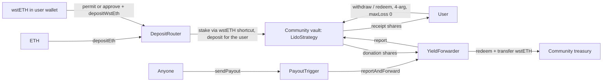

# Commonwell: architecture

## 1. Objective

A simple website where users pick a community, deposit into its vault (**ETH or wstETH** for the Lido type), and direct the yield to that community. Users keep their position as vault receipt shares and can withdraw it.

From the site, users can:
- sign in with a social login or a wallet;
- deposit, see their position and withdraw;
- send payouts;
- create a community.

**Networks.** Today the app runs on the **Hoodi testnet**, where a colleague can try every flow with test ETH from faucet links and no local setup. **Ethereum mainnet** comes next: it is the first deployment with real users and funds (see §9). The design is chain-agnostic, so more chains can follow: per-chain facts live in deployment files, and per-asset facts live in vault types.

**Vault types and assets.** Each chain can offer different vault types, and each type can take a different asset, so "deposit ETH or wstETH" is only what the Lido type accepts. The first community, Commons Hub Brussels, uses the Lido type (`lido-wsteth-v1`).

This is a standalone repository. The earlier [meliopolis/community-yield prototype](https://github.com/meliopolis/community-yield) is only a reference for product ideas: none of its contracts, addresses or secrets are used.

## 2. Decisions

| Area | Decision |
|---|---|
| Networks | One deployment file per chain; the app reads several and merges their communities. Hoodi (560048) for testing, because Lido runs a full deployment there with daily oracle reports (Sepolia's Lido is deprecated and earns nothing). Ethereum mainnet (1) is next. |
| Contracts | Unmodified Octant v1.3.0 (`06ae2b9`): one shared `YieldSkimmingTokenizedStrategy`, plus one `YieldForwarder` and one `LidoStrategy` per vault, `enableBurning = false`. Two custom contracts, shared per chain: `PayoutTrigger` and `DepositRouter`. |
| Payouts | Every forwarder's keeper is `PayoutTrigger`, so anyone can send a payout with a fixed 0% loss tolerance. No keeper key, server or cron. |
| Deposits | `DepositRouter` makes every deposit one transaction. It isn't part of any vault's address, so it can be replaced. |
| Deployment | Everything goes through the standard CREATE2 deployer (`0x4e59…956C`). Vaults are verified by recomputing their address. |
| Vault types | Versioned IDs with frozen code (`lido-wsteth-v1`). New code is a new ID. |
| Attestations | The official EAS where a chain has one (mainnet does). Hoodi has none, so it uses our own EAS v1.4.0 and SchemaRegistry. |
| Communities | Created in the app (or by the seed script): deploy forwarder → deploy vault → register → link. |
| Curation | Open registration. Any vault that passes the automatic check accepts deposits. A curator review adds the "Reviewed" label, the default view and a short URL (`/brussels`). |
| Frontend | Nuxt 4 static single-page app, Nuxt UI 4, `@wagmi/vue`, viem, Web3Auth (MetaMask Embedded Wallets) modal, Bun. Not React/Vite with ConnectKit, which doesn't support React 19 or wagmi 3. |
| Test ETH | Faucet links in the app, only on chains whose deployment lists faucets. |
| Hosting | Cloudflare Pages (project `commonwell`), connected to the GitHub repo: every push to `main` builds and publishes the static site. |
| Environments | `deployments/hoodi-dev.json` for development and `deployments/hoodi.json` for the shared demo (written by its first `deploy:core`). |

## 3. Contracts

**Roles**

| Setting | Assignment |
|---|---|
| Vault `management` | The community owner, who is also the EAS registration attester |
| Vault `emergencyAdmin` | The owner, by default |
| Vault `keeper` and `dragonRouter` | That vault's `YieldForwarder` |
| Forwarder `keeper` | `PayoutTrigger`, which is public |
| Forwarder `receiver` | The community treasury, which is immutable |

**PayoutTrigger** has no owner or storage and holds nothing. It exposes `sendPayout(forwarder, strategy)`, which is `reportAndForward(strategy, 0)`, and `forwardToken(forwarder, token)`. Anyone calling it can only:
- choose when a report happens, which is harmless: repeat reports don't double-pay, and depositors never earn the yield, so timing can't be exploited;
- pass a fake strategy, which makes the forwarder emit a junk `YieldForwarded` event but moves no funds (the app reads history from vault events only);
- flush forwarder-held tokens, which can only go to the treasury.

**DepositRouter** has no owner or storage, isn't upgradeable and holds nothing between calls. One transaction stakes ETH (`depositEth`) or takes wstETH (`depositWstEth`, or `depositWstEthWithPermit` with an EIP-2612 signature), reopens the vault if needed, and deposits with the user as receiver. It only moves `msg.value` or exactly `assets` from `msg.sender`, so an allowance to it can't be used by anyone else. ETH deposits mint exactly what was staked, so tokens sent to the router by mistake are never swept into a deposit. A permit someone submits first is ignored. The router isn't part of any vault's address, so a new version can be deployed without touching vaults.

Wallet confirmations per deposit: ETH takes one transaction. wstETH takes one transaction when the router is already approved or the wallet supports atomic EIP-5792 batches (approve and deposit together). Otherwise it takes a permit signature and one transaction. Web3Auth's embedded wallet only batches through EIP-7702, which it doesn't offer on Hoodi.

Vault types where withdrawals can lose value or reports swap tokens need a different payout policy.

**Authority and limits** (from the Octant source; a description, not a security guarantee):
- Management can replace roles, adjust health checks and permanently shut down deposits. Shutdown never blocks withdrawals or payouts.
- A donation-destination change takes at least 14 days and can be cancelled. Anyone can finalize it afterwards.
- No function lets management take depositors' principal.

**Behaviour verified in the Hoodi fork tests** (`contracts/test`):
- Deposits are valued in stETH. After a rate increase, withdrawals return the same value as fewer wstETH, and the difference is paid to the treasury.
- Repeat payouts pay 0. A vault that never had a deposit can't report (`"!profit"`).
- A rate dip blocks reports (`"!loss"`) until the rate recovers, or until management disables the check, which covers exactly one report. While the vault is worth less than its deposits, they pause.
- **Everyone withdrawing leaves rounding dust with no shares, which makes Octant block deposits.** `DepositRouter` reopens the vault inside the deposit transaction with two payouts; the second leaves a dust share at the forwarder.
- Tiny deposits can become unrecoverable dust, so the app's minimum deposit is 0.0001.

## 4. Community records and the automatic check

**EAS schemas**: no resolver, no expiry. The app ignores any record with an expiry.

| Schema | Fields | Rules |
|---|---|---|
| Community (non-revocable) | `string name, string description, string website, string imageURI` | With refUID 0 it's a registration: its UID is the community ID and its attester the owner. Later records referencing it are profile updates, accepted only from the owner; the latest wins. |
| CommunityVault (revocable) | `uint256 chainId, string kind, bytes32 salt, bytes params` | Recipient is the vault and refUID the community. Only the owner's links count; revoking one retires the vault. `params` is decoded by the vault type. |
| Endorsement (revocable) | `string slug, string note` | refUID is the community. Only addresses in the deployment's `curators` count. The earliest active review claims the short name. |

**Discovery** scans `Attested` logs from the deployment's EAS in block ranges that adapt to RPC limits, then reads the records with multicall. It sits behind one function, so a hosted index can replace it later.

**The automatic check** runs on every vault link:
1. **Address check.** The vault type rebuilds the forwarder and vault init code from `params`, the owner and its frozen code and addresses. The vault's CREATE2 address must equal the link's recipient, and both contracts must have code. A match proves the exact code, immutables and initial storage, whoever deployed it: a plain wallet, a Safe or a smart account.
2. **Live roles.** Management is the owner, and the keeper and donation address are the linked forwarder.
3. **No public contracts in a role.** Multicall3 and `PayoutTrigger` may not be owner, emergency admin or treasury.

A vault that fails is hidden from the directory, but its deposits stay withdrawable under My deposits.

## 5. Deployments and scripts

| Command | Purpose |
|---|---|
| `bun run keys` | Testnet-only keys in `.env.local`. Off testnets the scripts accept only Foundry keystores (`DEPLOYER_KEYSTORE`, `PAYOUT_KEYSTORE`). |
| `bun run contracts:build` | `forge build`, then generate ABIs and bytecode. A frozen vault type's bytecode is never overwritten. |
| `bun run deploy:core --deployment <name> [--chain <name\|id>] [--kinds a,b] [--fresh] [--live]` | CREATE2-deploys the shared contracts of every vault type that supports the chain (for Lido: trigger, implementation and router), uses the chain's official EAS or deploys one, registers schemas and writes `deployments/<name>.json`. A new deployment takes its chain from `--chain` (default Hoodi). `--fresh` gives an empty directory. Off testnets it needs `--live`. |
| `bun run seed --deployment <name>` | Two reviewed demo communities, each with a deposit. Idempotent. Testnets only. |
| `bun run payout --deployment <name>` | Every pending payout in one transaction |

The web app reads one or more deployments, one per chain (`NUXT_PUBLIC_DEPLOYMENTS`), and merges their communities (see the README's "Several chains"). Its only config is public: the Web3Auth client ID and the RPC URLs.

## 6. Frontend

- **Communities** (`/`): cards with total deposited, donated and ready to pay out (all in ETH, while every vault is a Lido one; see §9). Reviewed/Unreviewed tabs appear only when something is unreviewed. A footer line links to Create. Payouts are public housekeeping, not the main flow: each community page has a quiet "Pay out now" link next to the payout history, and curators get "Send all pending payouts" in the account menu.
- **Community** (`/<short-name>` or `/c/<id>`):
  - the header: logo, name and the Reviewed/Unreviewed badge (curators click it to review); one muted line under the name with "Check who runs it before depositing" when unreviewed, "Staked with Lido on <network>" (or "on N networks") and the website; the description below; an Edit button on the right for the owner;
  - warnings above the content when they apply: "Payout address change pending" (payouts can move to a new address after a date, once anyone finalizes the change) and "Not taking deposits" (no active vault; existing deposits stay withdrawable under My deposits);
  - vault tabs when the community has more than one active vault (every valid vault link that isn't retired; a select past four). A tab names only what tells the vaults apart: the network, the protocol, then the vault address for same-network, same-protocol vaults. The deposit card, the info column and technical details all show the selected vault;
  - one card with Deposit and Withdraw tabs and the user's deposit value. Deposit: an ETH/wstETH choice as two radio cards, shown only to users who hold wstETH, then the amount, Max (keeps gas on ETH), one button. Withdraw: amount as ETH value (like the deposit), paid out as the matching wstETH; Max redeems every share;
  - an info column (left on wide screens; on the right, a narrower sticky column holds the deposit card and the payouts) with four stats (total deposited, donated so far, the staking APR, and "Ready to pay out", the rewards earned since the last payout valued from a simulation; the APR source and payout status are info tooltips), the payout history with a quiet "Pay out now" link, the questions, and Technical details;
  - the APR is the vault type's source: for Lido, its 7-day average from Lido's API. The deposit form shows the matching yearly yield for the amount entered;
  - collapsed technical details at the end of the info column: the network, every contract and role address, the vault type, the EAS records, and links to the source.
- **My deposits** (`/me`): the total (in ETH; see §9), then one row per position (value in ETH) linking to its community, where it is withdrawn. Positions in retired or unlisted vaults, which their community page no longer offers, keep an inline Withdraw.
- **Create** (`/new`): profile and treasury, then four wallet confirmations, resumable after a reload.

**Flow rules**
- Every deposit is one router transaction; wstETH adds a permit signature unless the router is approved or the wallet batches. A failed deposit changes nothing, so there's no half-finished state to resume.

**Copy rules**
- Values lead.
- Never say "guaranteed" or "verified identity".
- Unreviewed communities get one line under the name: "Check who runs it before depositing".
- Only http(s) profile links are rendered.

## 7. Checks

| Command | What it covers |
|---|---|
| `bun run contracts:test` | Hoodi fork tests at a pinned block (yield and loss use a mocked rate): wiring, deposits through the router, withdrawals, payouts, losses, forwarder migration |
| `bun test` | Core unit tests: EAS encoding, CREATE2 vectors cross-checked against Solidity, discovery rules, validation reject cases, short names, link filtering, multi-chain merging, formatting, the frozen-code guard |
| `bun run typecheck`, `bun run web:typecheck`, `bun run web:generate` | Types and the static build |

The scripts (`deploy:core`, `seed`, `payout`) have been run end to end on a local Hoodi fork, and the pages checked in a browser against seeded data.

**Not yet verified on a hosted deployment:**
- the wallet flows in the browser, which need a real Web3Auth client ID: deposit, withdraw, payout, create, review;
- a payout after a real Lido report;
- a second person completing the flow on desktop and on a phone.

## 8. Known limits

- **Treasury changes.** A contract-level forwarder migration works, but the app doesn't relist the migrated vault. To change treasuries, create a new vault and retire the old link (see the runbook); until it's retired, the community page offers both.
- **Permanent registrations.** Test communities stay listed as Unreviewed until a `--fresh` reset of that deployment.
- **Admin actions in the CLI.** Shutdown, health-check override and retiring a link use `cast`, as described in the runbook.
- **Curator list in the build.** Changing curators means editing the deployment file and pushing it to `main`, which rebuilds the site.
- **Deferred:** withdrawing in the token deposited, such as ETH from a Lido vault. Mainnet launches with withdrawals in each vault type's asset (wstETH for Lido), and the info tip on the deposit form's "You keep" row says so before the deposit. Also deferred: per-user donation totals, ownership handover, an automatic payout job.

## 9. Networks and vault types

**Rule:** nothing outside a deployment file or a vault-type module may assume a chain or an asset. Per-chain facts (addresses, EAS, explorer, RPCs, faucets, curators) belong in `deployments/<name>.json`; before a deployment exists, the scripts take them from `scripts/networks.ts`. Per-asset facts (the asset, deposit paths, valuation, APR source, payout policy) belong in `packages/core/src/kinds/<id>.ts`, and the scripts' side of a vault type (supported chains, shared contracts, verification, seed deposit) in `scripts/kinds/<id>.ts`.

**Still tied to Hoodi or Lido:**
- `scripts/keys.ts` writes testnet-only keys, which must never sign on mainnet (`deploy:core` needs `--live` off testnets, and `seed` refuses to run there);
- `seed` creates vaults of the default type only, because `createCommunity` builds Lido-shaped vault settings;
- the chains the app knows (`chainFor` in `packages/core/src/config.ts`): Hoodi and mainnet;
- one Web3Auth network for the whole build (`web3AuthNetwork`, now `sapphire_devnet`);
- the fork tests, which run against Hoodi only;
- the deposit and withdraw mechanics: the deposit routes (staking ETH, permits, approvals and batches), the balances query, position valuation and withdrawal conversion (Lido's 1e18-scaled exchange rate). Their wording and units, including each unit's decimals, already come from the vault type and the chain. The mechanics move behind the type with the second vault type, whose example shows what's actually shared.

**Ethereum mainnet (next):**
- `bun run deploy:core --deployment mainnet --chain mainnet --live`, which uses the official EAS from `scripts/networks.ts`; first confirm mainnet EAS v0.26 matches the calls used (`attest`, `revoke`, `getAttestation`, `Attested`);
- off testnets the scripts sign only with Foundry keystores (`DEPLOYER_KEYSTORE`); a hardware wallet would remove the key from disk entirely, which matters only if the deployer ever holds more than gas;
- fork tests against mainnet as well as Hoodi;
- production work: a security review, Safe admins and curators (the CREATE2 check already supports Safes), a paid RPC, a hosted index instead of log scanning, Web3Auth's mainnet network, and probably an automatic payout job;
- separate sites: the mainnet site lists only mainnet vaults, so everything on it is real money; testnets keep their own demo site, with faucet links and test-money wording.

**Other chains:**
- **L2s.** Lido vaults don't port, because bridged wstETH has no `stEthPerToken()`. Other strategies are needed there.
- **Vault types per chain.** A chain's deployment file lists the types it offers (`kinds`), and a community can have vaults of different types on different chains, so the same community may take wstETH on one chain and another asset elsewhere. The UI asks the vault type for its asset, deposit paths, valuation and APR rather than assuming ETH. Its wording comes from the type too (`copy` in the type module: how it earns, the rate label, its FAQ answers and risks), so components don't name Lido; an unknown type falls back to neutral wording. The type also gives its value unit (`valueUnit`, ETH for Lido), the asset withdrawals pay out (`assetUnit`), its deposit options (`copy.depositOptions`) and its minimum deposit. Gas and faucet wording use the chain's own currency (`nativeUnit`). A unit is a symbol together with its decimals, so amounts display and parse correctly for a 6-decimal asset too. The deposit and withdraw mechanics are still Lido's own, as listed under "Still tied" above.
- **Totals across assets.** Totals go by each vault type's value unit (`valueUnit`), not its token. A total over vaults that share one unit is shown in that unit, as today: ETH for Lido vaults and for any other ETH-valued type, such as Rocket Pool. A total over several units is shown as one approximate USD value, and its tooltip lists the exact amount for each vault in that vault's own asset. Examples: a community card when the community's vaults hold different assets, or My deposits when your positions do. If a price can't be loaded, the total falls back to the per-asset amounts instead of a partial USD figure.
  - Only these totals are converted. A single vault's figures, inputs and positions stay in their own asset, as bigint, following AGENTS.md.
  - Price source: Chainlink feeds, read on-chain.
    - One USD feed per value unit (ETH/USD first). The feeds are always read on Ethereum mainnet, whatever chain the vault is on, so a deployment needs no feed of its own.
    - It uses the same RPCs and multicall as the rest of the app: no key, no server and no extra third party.
    - It sits behind one core function (`usdPrice(valueUnit)`), so a price API such as DefiLlama's (free and keyless) could cover a unit without a Chainlink feed.
    - Testnet sites show no USD, because their tokens have no value.
    - Rejected options:
      - CoinGecko: a static site would expose its key, and the free quota would be shared by every visitor.
      - Pyth Hermes: it now requires an API key.
    - Built when the first type with a different value unit arrives.
  - Today a total is shown only when its vaults share a value unit (`sharedValueUnit`). Otherwise a community card shows a dash, and My deposits leaves its total out, until USD totals exist.
- **More vaults per community.** The data, core logic and community page already support several active vaults, on one network or several. Add an owner "Add vault" action together with the second vault type.
- **Other Octant strategies.** Each is a new type module, frozen code, a config entry and fork tests.
  - `RocketPoolStrategy` (rETH, same accounting and trigger) is the easy next one.
  - Yield-donating types (Aave, ERC4626, Morpho, Spark, Yearn, Sky) need:
    - their own implementation;
    - an allowlist of target vaults;
    - asset-based position math.
  - Sky swaps during reports, so its payouts should be keeper-only.
